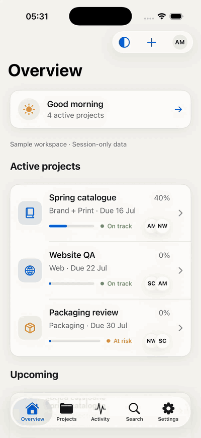
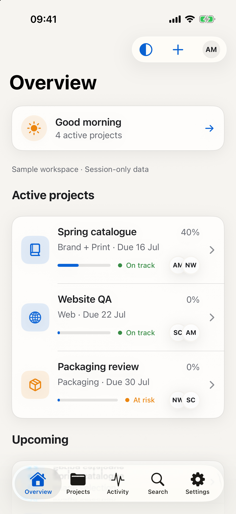
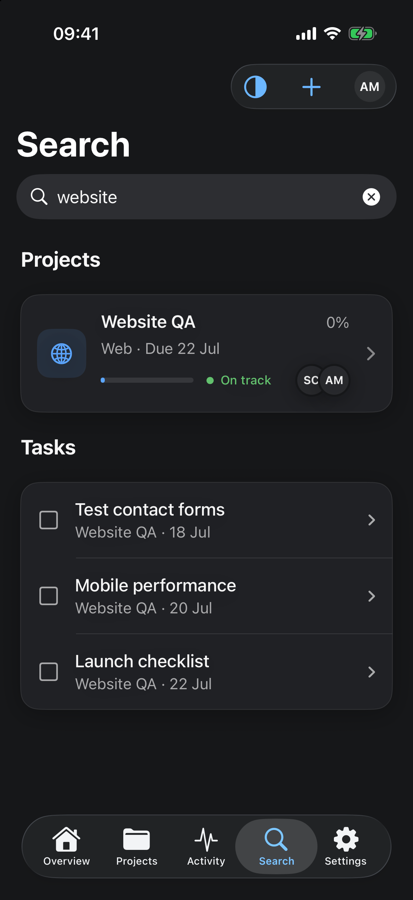
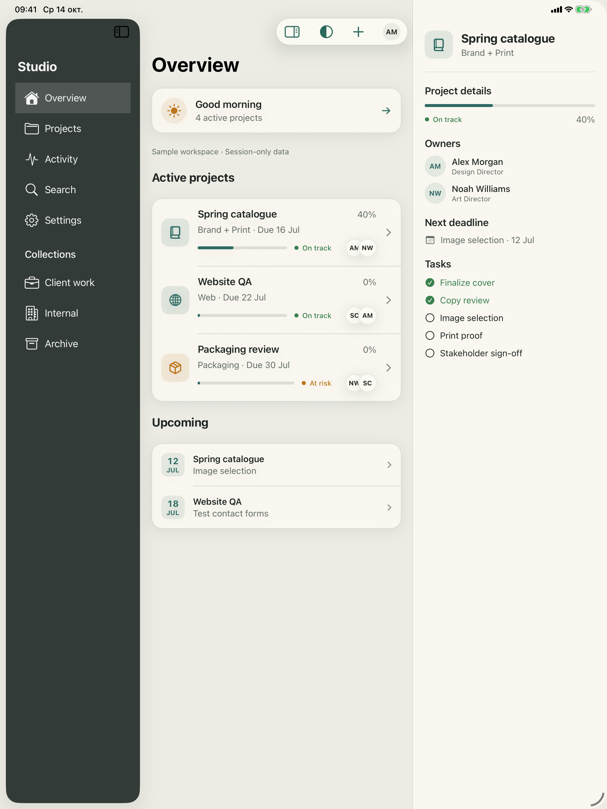
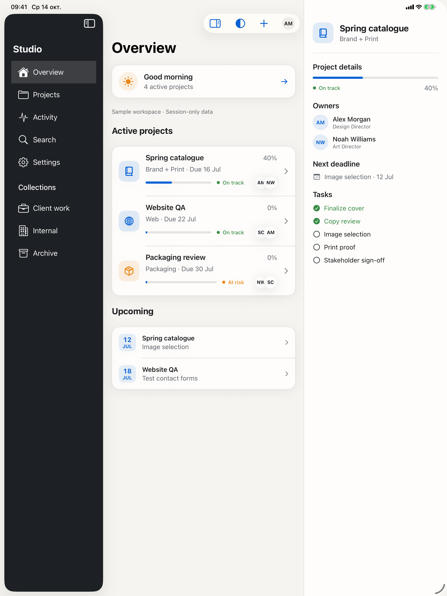

# Adaptive App Shell

A production-oriented SwiftUI shell that uses bottom tabs on iPhone and a sidebar with an optional inspector on iPad while preserving the same navigation state.

[](https://www.swift.org)
[](https://developer.apple.com/ios/)
[](https://github.com/mikonyaa/AdaptiveAppShell/actions/workflows/ci.yml)
[](LICENSE)

Part of the [Apple Design Templates](https://github.com/mikonyaa/Apple-Design-Templates) collection.



## Simulator screenshots

| iPhone · Classic | iPhone · Graphite Search |
| --- | --- |
|  |  |

| iPad · Stone | iPad · Classic with Inspector |
| --- | --- |
|  |  |

## What this solves

- System `TabView` navigation in compact width
- `NavigationSplitView` sidebar in regular width
- Optional contextual inspector without duplicating feature state
- Independent `NavigationStack` path for every destination
- Sidebar-only collections that do not overload the iPhone tab bar
- App-owned typed routes and deterministic path replacement
- Reactive section changes with predictable selection reconciliation
- Native Liquid Glass system chrome on iOS 26
- Opaque, readable fallback chrome on iOS 17–25
- Dynamic Type, VoiceOver, Increase Contrast, and Reduce Transparency support
- Three semantic, gradient-free themes: Classic, Graphite, and Stone

The package contains the reusable shell only. The studio workspace in `Examples` demonstrates integration without leaking demo models into the library.

## Requirements

- Xcode 16.4 or newer
- Swift 6
- iOS 17 or newer
- macOS 14 or newer for package consumers

Xcode 16.4 builds the compatibility branch. Xcode 26 or newer also compiles the guarded native Liquid Glass APIs. The deployment floors remain iOS 17 and macOS 14.

## Run the demo

Open the ready-to-use Xcode project:

```bash
open Examples/AdaptiveShellDemo/AdaptiveShellDemo.xcodeproj
```

Select the `AdaptiveShellDemo` scheme and run on an iPhone or iPad simulator.

Optional: regenerate the Xcode project with XcodeGen if you prefer project files generated from a spec:

```bash
cd Examples/AdaptiveShellDemo
xcodegen generate
open AdaptiveShellDemo.xcodeproj
```

XcodeGen is not required to use the template. The checked-in `.xcodeproj` is ready to open.

## Installation

Add the package in Xcode using its GitHub URL, or declare it in `Package.swift`:

```swift
.package(
    url: "https://github.com/mikonyaa/AdaptiveAppShell.git",
    from: "1.0.3"
)
```

Then add `AdaptiveAppShell` to the application target.

For local development, choose **Add Local Package** and select this directory.

## Minimal integration

```swift
import AdaptiveAppShell
import SwiftUI

enum AppTab: Hashable, Sendable {
    case home
    case library
    case settings
}

enum AppRoute: Hashable, Sendable {
    case detail(String)
}

struct RootView: View {
    @State private var shellState = AdaptiveShellState<AppTab, AppRoute>(
        selection: .home
    )

    private let sections: [AdaptiveShellSection<AppTab>] = [
        AdaptiveShellSection(
            id: "main",
            items: [
                AdaptiveShellItem(
                    id: .home,
                    title: "Home",
                    systemImage: "house",
                    selectedSystemImage: "house.fill"
                ),
                AdaptiveShellItem(
                    id: .library,
                    title: "Library",
                    systemImage: "books.vertical",
                    selectedSystemImage: "books.vertical.fill"
                ),
                AdaptiveShellItem(
                    id: .settings,
                    title: "Settings",
                    systemImage: "gearshape"
                )
            ]
        )
    ]

    var body: some View {
        AdaptiveAppShell(
            title: "My App",
            sections: sections,
            state: shellState,
            content: { item, navigation in
                switch item.id {
                case .home:
                    HomeView {
                        navigation.push(.detail("welcome"))
                    }
                case .library:
                    LibraryView()
                case .settings:
                    SettingsView()
                }
            },
            destination: { route in
                switch route {
                case .detail(let id):
                    DetailView(id: id)
                }
            }
        )
        .adaptiveShellTheme(.classic)
    }
}
```

Use two to five items with `.tab` compact placement. Extra regular-width destinations belong in sidebar sections with `.hidden` compact placement.

The shell reconciles additions, removals, reordering and compact placement changes. It keeps a valid selection, otherwise chooses the first visible item in configuration order. Empty configurations show **No destinations**. Paths remain app-owned when an item is hidden or removed, so reinserting the same ID restores its history. For duplicate section or item IDs, the first occurrence wins. See [migration and configuration rules](Docs/Migration-1.0.4.md).

## Inspector integration

Use the full initializer when selected content benefits from a regular-width inspector:

```swift
AdaptiveAppShell(
    title: "My App",
    sections: sections,
    state: shellState,
    showsInspector: { item in item.id == .library },
    content: { item, navigation in
        content(for: item, navigation: navigation)
    },
    destination: destination,
    inspector: { item in
        InspectorView(selection: item.id)
    }
)
```

The inspector is optional and controlled from the system toolbar. The demo's **Keep inspector open** preference opens it when a project is opened; turning the preference off permits manual control.

## Themes

Themes expose semantic tokens instead of hard-coded view colors:

```swift
.adaptiveShellTheme(.graphite)
```

Create a custom theme by initializing `AdaptiveShellTheme`. In `1.x`, its ID identifies the closest built-in preset family; custom theme identity is reserved for a future major version. No theme uses a gradient. Content surfaces remain opaque; Liquid Glass is reserved for system navigation and interactive controls.

## Project structure

```text
AdaptiveAppShell/
├── Sources/AdaptiveAppShell/       Reusable package
├── Tests/AdaptiveAppShellTests/    State and model tests
├── Examples/AdaptiveShellDemo/     iPhone and iPad demo app
├── Docs/                           Architecture and integration guides
├── Design/Mockups/                 Approved visual references
├── Assets/                         Simulator screenshots and GIF
└── Scripts/                        Reproducible showcase capture
```

## Documentation

- [Getting started](Docs/GettingStarted.md)
- [Architecture](Docs/Architecture.md)
- [Customization](Docs/Customization.md)
- [Demo-level state restoration recipe](Docs/StateRestoration.md)
- [Accessibility](Docs/Accessibility.md)
- [Template quality checklist](Docs/QualityChecklist.md)
- [Interactive Studio walkthrough](Examples/AdaptiveShellDemo/README.md)
- [Candidate release notes](Docs/ReleaseNotes-1.0.4.md)
- [Validation matrix and remaining device checks](Docs/Validation.md)

The demo stores projects, task changes, settings and search context in memory for the current window session. **New project** creates and opens a real local record; no account or backend is required. Project actions open a detail stack in both presentations, and the optional inspector reads the same model. Unknown links show an explicit message and preserve the existing navigation.

## Verification

```bash
swift test
swiftlint lint --strict

xcodebuild \
  -project Examples/AdaptiveShellDemo/AdaptiveShellDemo.xcodeproj \
  -scheme AdaptiveShellDemo \
  -destination 'generic/platform=iOS Simulator' \
  CODE_SIGNING_ALLOWED=NO \
  build

(
  cd Examples/AdaptiveShellDemo
  xcodegen generate
)

Scripts/run_ui_tests.sh iphone
Scripts/run_ui_tests.sh ipad
```

The UI script creates and removes only its own simulator and builds a separate public-API consumer outside the checkout. XcodeGen **2.45.4** and SwiftLint **0.65.0** are pinned in CI; the full workflow keeps Xcode 16.4 and 26.5 gates. Physical VoiceOver, keyboard, Stage Manager and adoption checks are tracked separately in the validation matrix.

## License

MIT. See [LICENSE](LICENSE).
